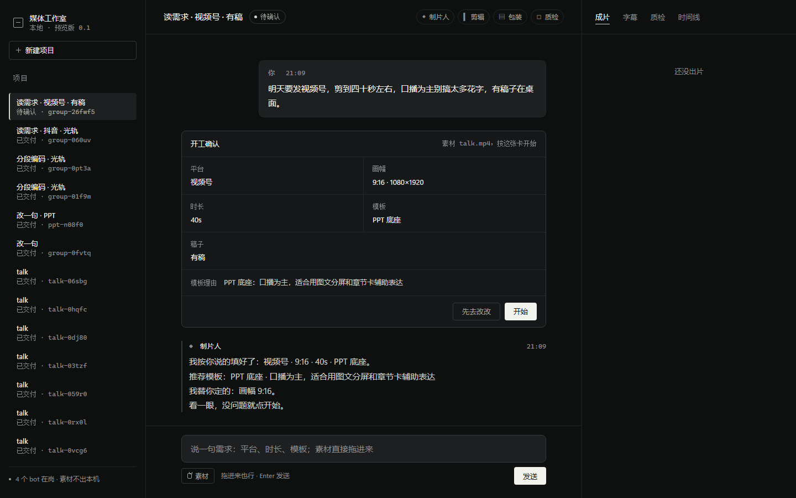
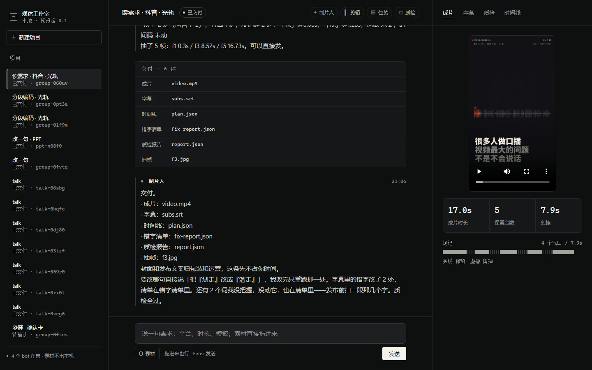
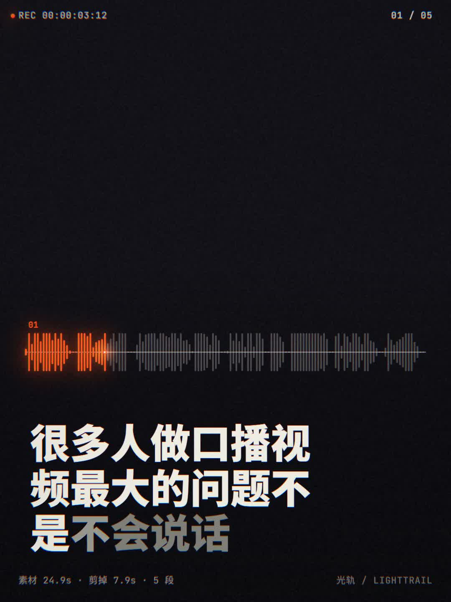
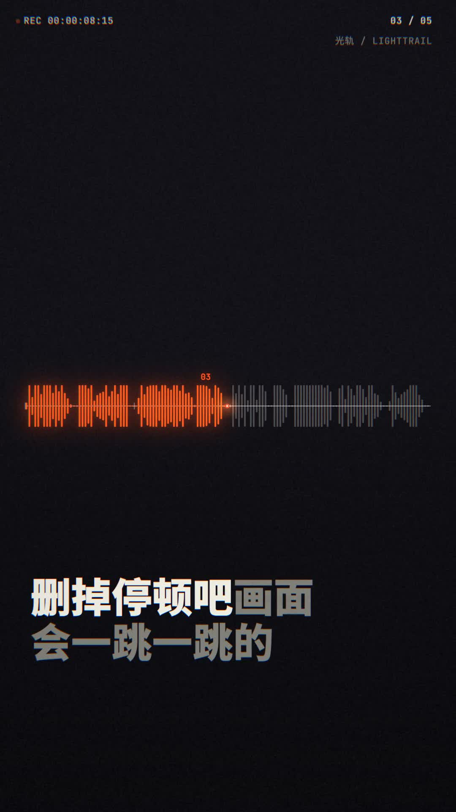
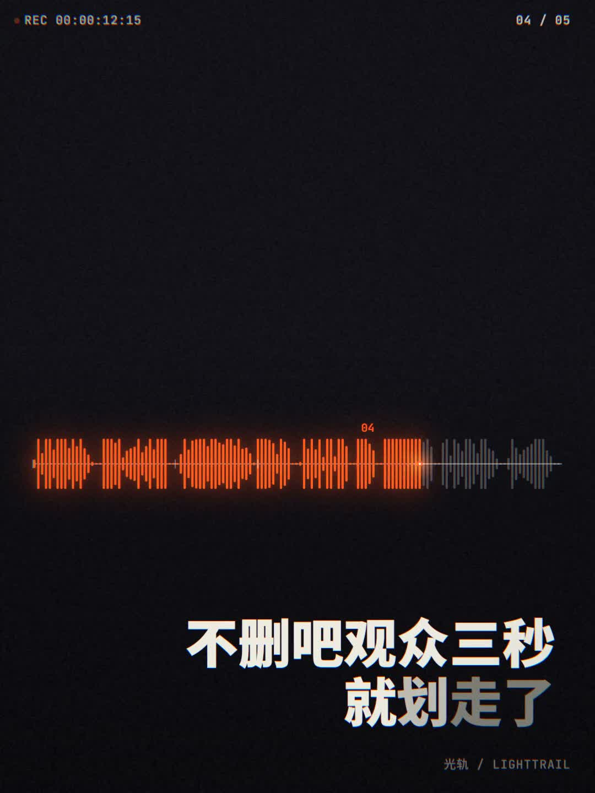
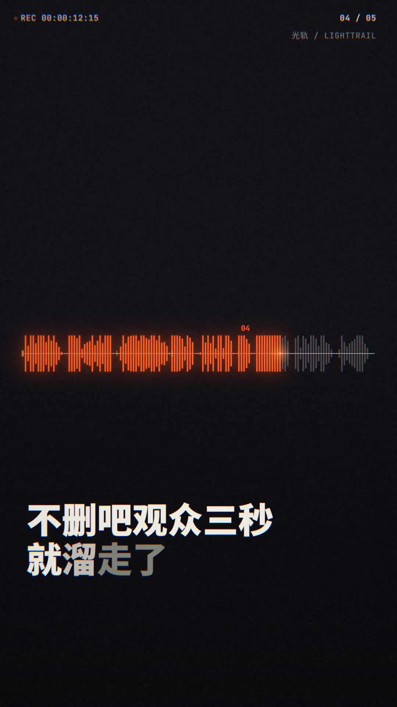
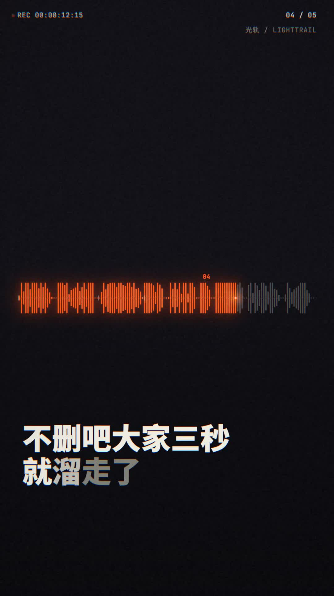

# Vision Bots

一句话：**一个主 bot 带一队小 bot，在一张群聊里把口播素材做成能直接发布的片子。**

前台是群聊，不是功能面板。skill、模板、模型都在 bot 里面，用户只跟人说人话。

> 仓库代号 `ds-media-studio`（目录名、`bin` 名 `dsm` 沿用），对外产品名 **Vision Bots**。

## 现在能跑什么

丢一段口播素材进去，四个 bot 依次交接，界面和 CLI 是同一套编排：

```
你：丢素材 + 「按折光做个 60 秒的，发视频号」
◆ 制片人  读需求：模型定规格，规则逐个字段校验，出确认卡（平台 / 画幅 / 时长 / 模板 / 稿子）
◆ 制片人  定 Goal，派活
▍ 剪辑    热词注入转写 → 错字治理 → 气口检测 → 保留区间 → 字幕卡
◆ 制片人  核对目标：到不了 60s，说清楚差在哪，不改用户目标
▤ 包装    按模板出片（光轨 / PPT 底座 / 纯字幕）→ 场记 → 预览帧
◻ 质检    逐项检查（含错字治理）+ 抽帧，每条结论带数字
◆ 制片人  交付（成片 / 字幕 / 时间线 / 错字清单 / 质检报告 / 抽帧）
```





实测（本机，24.93s 中文口播，faster-whisper small / CPU）：

| 环节 | 耗时 | 结果 |
|---|---|---|
| 读需求 | 3.7–5.7s | 模型提字段 + 规则校验；「一分半」「四十秒左右」这类中文数字也认 |
| 转写 | 19–25s | 60 词，词级时间戳 |
| 错字治理 | 10–17s | 术语表 2 处 + 模型提案，全部过校验，2 个低置信词进清单 |
| 剪辑决策 | 0.1s | 5 段，剪掉 7.9s（4 个长停顿） |
| 渲染 | 6–11s（PPT 9:16 18–23s；光轨 46–84s） | 1080×1440 或 1080×1920，−17.1 LUFS |
| 质检 | 1s | 6 项全过，5 张抽帧 |

## 制片人：读需求

一句话进来，模型把它定成一条片子的交付规格；能不能用，由校验器说了算。

- **分工是死的**：模型只提判断（平台 / 画幅 / 时长 / 模板 / 有没有稿），字段合不合法由 [src/brief.mjs](src/brief.mjs) 逐个验——模板必须是 roster 里 `ready` 的 id，画幅必须是这个模板真做过的，时长夹在 8–300s。
- **用户原话优先**：原话里明确说了的，模型改不掉。模型把「四十秒」记成 90s，卡片上还是 40s，并把这次读岔记进 `brief.corrected` 在群里说明（差 12% 以内算「左右」的容差，不啰嗦）。
- **中文数字也认**：`一分半` → 90s、`四十秒左右` → 40s、`半分钟` → 30s、`别超过一分钟` → 60s；`1.5分钟`、`90秒` 同样认。
- **替你定的要列出来**：模型补的、按默认兜的，都进 `brief.assumed`，群里逐条说「我替你定的：画幅 9:16」——不把默认值说成你说的。
- **模型没接上就说实话**：网关不通 / 超时 / 返回不是 JSON，退回纯规则（和接模型之前的行为一致），群里写「模型没接上：timeout，这版是规则填的」。
- 读需求时群里先出一行「制片人在读需求…」，同一个 bot 开口后自动收起，不让群停在空白里。

实测（本机 OpenCodex，`gpt-6-luna--fast`）：四句话 3.7–5.7s；说 9:16 出来的就是 1080×1920，说光轨就是逐帧渲染 + 关键帧栅格切片。

`node scripts/check-brief.mjs` 跑 47 条自检（时长 10 / 规则 6 / 用户优先 10 / 模型补位 3 / 没模型 3 / 校验 6 / 接入 4 / 模板理由 4 / 画幅 1）：模型输出用固定样本喂，不联网也能验「哪些话能信、哪些要拦」。

模型网关默认 `http://127.0.0.1:10100/v1` + `gpt-6-luna--fast`，用 `DSH_MEDIA_LLM_BASE` / `DSH_MEDIA_LLM_MODEL` / `DSH_MEDIA_LLM_KEY` 覆盖；凭证默认读本机 codex 登录态，不入库。错字治理和读需求共用这一个客户端（[src/llm.mjs](src/llm.mjs)），失败口径一致。

## 画幅：3:4 与 9:16

画幅不是渲染参数，是模板的一部分：`template.json` 里每个画幅一份 `layouts`，几何全在里面，引擎里没有写死的坐标。

- **换画幅不动时间线**：`scene.json` 只带 `ratio` 和 `size`，剪辑决策、分段、字幕一字不改，布局在渲染时查表。3:4 改完布局表重渲同两帧，和改之前**逐像素一致**。
- **光轨的 9:16 不是把 3:4 拉伸**：右侧留 200px 给平台按钮条，底部留 340px 给账号与文案区，页脚（素材统计 / LIGHTTRAIL）从画面底部移到顶部 HUD，大字改成一律左对齐。这些数字都在 `layouts["9:16"]` 里。
- **平台决定默认值，卡片可以改**：说「发抖音」默认 9:16，明说「竖屏」「3:4」就按说的。模板没做的画幅，制片人当场说明并按模板默认画幅出，不静默改尺寸。
- 一致性由 `node scripts/check-templates.mjs` 查：roster 声明的画幅必须和 `template.json` 的 `layouts` 一一对上，对不上直接 FAIL。

## 模板：PPT 底座


`templates/ppt-base/` 是「引擎代码 + template.json」，运行时产出 `scene.json`：

- 分章取 ASR 的整句，不按字数硬切（早期按 12 字切出过只剩「的」的章节）。
- 章节卡在章首出现 1.7 秒后淡出，顶底各一条遮罩保证字在任何画面上都读得清。
- 画幅、字号、边距、遮罩全在 `template.json` 里；换模板不改时间线。
- 章节卡断行按**词**断：断点来自 `src/segment.mjs` 的分词（ICU 中文词典 + 术语表合并回整词），不按字数硬切；末行只剩一两个字时从上一行借一个词，`的 / 了 / 吧` 这类单字助词不许起行（并回上一行后那一行宽一个字，字号按最长行自动缩）。
- 顶底遮罩是**渐变**：一块纯色 drawbox 会在遮罩下沿留一条硬边（实测整图跳 14 级亮度），现在拆成 32 条带插值，同一位置降到 0 级。
- 9:16 的章节卡下移到 168px、字幕底距 330px，给抖音底部的账号与文案区让位。


## 模板：光轨



光轨不是 ASS 字幕，是**逐帧渲染**：`vendor/lighttrail` 的 canvas 引擎跑在无头 Chrome 里，每一帧都是 `scene.json` + 时间的纯函数。

- **一线到底**：开场从中心点燃一条线（0.1s）→ 整屏扫描一次（0.5s）→ 展开成声波基线，走过的部分是信号橙、没走过的压成灰，最后一个光头收在末帧。
- **大字按音节落**：每章一句整话上屏，逐字由灰翻白，翻的速度就是语速；不截断、不缩写成关键词。断行同样按词（`scene.json` 里每章带 `words`，画布引擎只管按词排，不猜词边界）。
- **章节齿**：每章在光轨上留一个刻度，`01/05` 跟着走——这是剪辑时间线，不是装饰。
- **一章一句**：残句（不到 4 字或不到 1 秒）并进上一章，短章可以并但并完不超过 20 字；大字挂到本章结束为止，不在句子中间撤走。规则在 `src/chapters.mjs`，两个模板共用。
- **音效只回应动作**：点燃 click、拉线 zip、扫描 scan、每章一下 impact、收尾 drop，全部本地合成（`src/sfx.mjs`，无样本文件）。
- 只有四色：夜 `#0A0A0D` / 骨白 `#F1EDE4` / 信号橙 `#FF5A1F` / 灰 `#8B8983`。
- **9:16 单独排过**：光轨在 0.5h，大字带进到距底 340px，页脚上移到顶部 HUD；右侧 200px、底部 340px 是给平台 UI 的留白，不是随手留的。
- **改一句只重编那一格**：成片按 32 帧一格落关键帧，改到的格子单独重编，前后从上一版成片流拷贝拼回来（`src/encode-film.mjs`）；拼完把两条片子各解一遍逐帧对账，窗口外有一个像素不对就整条重编。
- **改一句只重渲那一句**：母版存在群目录的 `cache/` 里。改一章的字，只有那一章显示区间（±2 帧）重渲，其余帧从母版流拷贝切出来拼回去；改动覆盖超过 45% 才整条重渲。抽好的源帧、切好的声音、量好的包络也按指纹复用；整条没变就直接交回上一版成片（0.01s）。判据在 `src/render-cache.mjs`。



实测（24.93s 素材 → 17.0s 成片，511 帧，5 章）：抽帧 2.6s、逐帧渲染 50.0–50.2s（**0.34× 实时**；同一素材历史区间 46–84s，0.20–0.37×，差异来自本机负载）、编码 33.1s（整条重编，含关键帧栅格）、成片 17.0 MB、质检 6/6 全过。1080×1920 一版：511 帧、17.0 MB、−17.1 LUFS、6/6。

## 错字治理

字幕上留一个错字，这条片子就不能直接发。两层都在剪辑阶段做完：

1. **热词注入**（转写前）：`config/terms.json` 的术语表进 faster-whisper 的 `initial_prompt`，让它一开始就少写错。
2. **受约束纠错**（转写后）：术语表做确定性替换，再加模型按**词位索引**提修改，全部过校验器。

校验器只放行四类，每一处都要自证：

| 类别 | 放行条件 |
|---|---|
| 同音字 | 拼音完全一致（pypinyin 实测；本机没有拼音能力就进保守模式） |
| 专有名词 | 命中术语表 |
| 数字 | 只修阿拉伯数字写错；「三秒→3秒」这种改写两个方向都拦 |
| 标点 | 字幕层统一剥掉，不需要改 |

字数变了、词位越界、同一词位改两次、一个词位里塞空格，一并打回。硬约束是**只改词文本**：词数与每个词的起止时间由模块内部断言，动了直接中止。

术语表还要能抓「被拆开的错」：`{"to":"划","from":["化","画"],"next":"走"}` 的意思是「化或画，紧跟『走』时改成划」——ASR 常把「划走」拆成两个词，模型看不出来，术语表看得见。

**模型的提议不作数，只有过了校验才算改。** 同一段素材跑三次，转写分别给出「检,」「减。」「化」——低置信片段会走 temperature fallback，转写不是逐字节可复现的。所以确定性的一半（术语表）必须在：把模型关掉、只跑术语表，这条转写照样能修干净（回归脚本在 `.test/`，不入库）。



实测（24.93s 口播，60 词）：术语表修 2 处（化→划、减→剪），模型 1 提案 0 采纳（「三」→「3」被打回），2 个低置信词进交付清单；错字治理 10.1s（模型 10.1s / 972 tokens）；词数与时间码未动。

## 改一句

交付之后说一句「把『划走』改成『溜走』」，就重出这一版——不重跑转写、不重剪、不动时间线。

- **只改字的文本。** 词数、每个词的起止时间由 `src/revise.mjs` 内部断言，动了就中止并如实说。时间线是剪辑定的，一句话改不了它。
- **跨词修正。** ASR 常把「划走」拆成「划」+「走了。」两个词。匹配时把词摊平成字符流再找，改完按原词边界摊回去，逐字落点不动。
- **说不清就不改。** 一句话里同一个词出现两次、或这条片子里根本没有，制片人把位置列出来问清楚，不猜着改。
- **只重渲这一处。** 改字之后 scene 只有那一章变了，`src/render-cache.mjs` 算出受影响的帧，其余从母版流拷贝切回来。
- **只重编这一格。** 成片每 32 帧一个关键帧，改动扩到整格（这次是 288–415，128 帧）单独重编，前后从上一版成片流拷贝拼回去；拼完两条各解一遍逐帧对账，窗口外一帧不对就整条重编。
- **字幕跟着走。** SRT 由包装按这一版重写，不会出现「片子里改了、交付的字幕还是旧的」。

实测（24.93s 素材 → 17.0s 成片，第 4 章「划走」→「溜走」）：

- 光轨 9:16（canvas，511 帧）：只影响第 311–389 帧（15%），重渲 79 帧用 11.9s，**整条 31.4s**（编码 14.2s：只重编 128 帧 + 逐帧对账），质检 6/6。
- 同一版里接着再改一次（「人群」→「大家」）：同样 31.4s，窗口外 383 帧与上一版逐帧一致——切点和关键帧栅格能一直复用下去。
- PPT 底座 9:16（ffmpeg）：整条重烧 11.4s（这条模板本来就快，没有分段缓存），质检 6/6。

两条模板改完，成片、SRT、scene.json 三处的字一致。`node scripts/check-revise.mjs` 跑 24 条自检（解析 7 / 定位 6 / 改字 6 / 断言 3），用合成词流，不依赖素材。






## 界面

群聊三栏：左项目、中对话、右项目面板。设计变量在 [web/tokens.css](web/tokens.css)，按角色命名（`--chalk`、`--slate`、`--edge`、`--cue`、`--flag`），改一处全站生效。

- 单一视觉焦点：一屏只有成片是亮的；其余靠字重、明度和 1px 线分层，不靠颜色。
- **场记条**是这套界面的签名元素：保留段按源时长等比排开，被剪掉的气口留成虚槽——这条片子剪了什么，一眼看得见。
- 不用 emoji 当图标，状态用明度阶梯；唯一彩色是质检失败的暗红。
- 间距只走 4/8/12/16/24/32/48。

## 快速开始

```bash
node src/server.mjs                     # 界面 http://127.0.0.1:4188
node bin/studio.mjs demo --input 素材.mp4    # 命令行跑一遍全过程
node bin/studio.mjs demo --input 素材.mp4 --template 光轨 --duration 60   # 换模板
node bin/studio.mjs demo --input 素材.mp4 --template 光轨 --ratio 9:16    # 竖屏
node scripts/check-templates.mjs            # 模板一致性（roster 画幅 ↔ template.json）
node scripts/check-wrapping.mjs              # 断行只许落在词边界上
node scripts/check-patch.mjs --group <群 id>  # 分段缓存：改一句只重渲那一句，画面等于整条重渲
node scripts/check-revise.mjs                # 改一句：解析 / 定位 / 改字 / 时间码断言 24 条
node scripts/check-encode.mjs                # 分段编码：关键帧栅格 / 只重编一格 / 窗口外逐帧一致 14 条
node scripts/check-brief.mjs                 # 读需求：时长解析 / 模型字段校验 / 用户原话优先 47 条
node scripts/check-asr-fix.mjs               # 错字治理：术语表 / 校验器 / 句子回流 / 硬断言 33 条
node bin/cut.mjs -i 素材.mp4 -o 成片.mp4  # 只跑视频管线，不经过 bot 层
```

界面上素材可以直接拖进来或点「素材」选文件，跟着下一句话一起发。

需要 ffmpeg（`FFMPEG_DIR` 或 PATH），转写需要 `uv`（自动装 faster-whisper，锁 `av<14`）。

光轨模板另外需要 Chrome 与一套中文字体：`LIGHTTRAIL_CHROME` 指向 chrome.exe，`LIGHTTRAIL_FONTS` 指向含 `NotoSansSC.ttf` 的目录（字体 18MB 不进仓库）。找不到会直接报错，不会静默退化成别的模板。

## 目录

```
src/
  bots/roster.mjs        四个长驻身份 + 模板注册表（模板决定交付规格）
  core/group.mjs         群 = 项目现场：事件流、素材、工作目录、产物
  core/runner.mjs        一次干活：状态、进度、产物、失败原因
  core/orchestrator.mjs  阶段机：接需求 → 确认 → 派活 → 验收 → 交付
  handlers/cut.mjs       剪辑：转写 + 决策 + 字幕
  handlers/pack.mjs      包装：按模板渲染，落 scene.json
  handlers/qc.mjs        质检：检查 + 帧证 + report.json
  plan.mjs captions.mjs render.mjs qa.mjs asr.mjs   确定性视频管线
  brief.mjs              读需求：模型定规格 + 规则逐字段校验（用户原话优先）
  llm.mjs                本机模型客户端：读需求和错字治理共用配置与失败口径
  asr-fix.mjs            错字治理：热词注入 + 受约束纠错（只改词文本）
  chapters.mjs           分章规则：残句并走，并长了不并（两个模板共用）
  segment.mjs            中文分词：断行只落在词边界上（零依赖：ICU + 术语表）
  sfx.mjs                音效合成（本地，无样本）
  render-cache.mjs       分段缓存：算哪几帧变了，把母版切出来拼回新母版
  encode-film.mjs        分段编码：关键帧栅格 + 只重编变化的那一格 + 逐帧对账
  revise.mjs             改一句：一句话 → 定位到词 → 只改文本（词数与时间码断言）
  server.mjs             本地 HTTP + SSE + 素材上传
scripts/check-templates.mjs  模板一致性：roster 的画幅必须和 template.json 的 layouts 对上
scripts/check-wrapping.mjs   断行自检：只许在词边界换行，一个字不许丢
scripts/check-revise.mjs     改一句自检：解析 / 定位 / 改字 / 断言
scripts/check-encode.mjs     分段编码自检：栅格 / 只重编一格 / 窗口外逐帧一致
scripts/check-brief.mjs      读需求自检：时长解析 / 字段校验 / 用户原话优先 / 模板理由
scripts/check-asr-fix.mjs    错字治理自检：术语表 / 校验器 / 句子回流 / 硬断言
templates/lighttrail/    光轨：index.mjs + scene.mjs + film.js + render.mjs + template.json
templates/ppt-base/      模板：index.mjs + template.json
vendor/lighttrail/       canvas 逐帧引擎（engine/ + tools/render.mjs）
config/terms.json        术语表：热词 + 同音错对照组（可被群级 terms.json 覆盖）
tools/asr.py pinyin.py   转写（词级时间戳）/ 拼音校验
web/                     群聊界面（tokens.css / style.css / app.js）
groups/<群 id>/          一个项目：events.jsonl / assets / work / out
```

## 硬规矩

- **时间码只由管线产生。** 模型只做判断和措辞，不碰时间码、不改代码。
- **模型给的字段要过校验器。** 平台 / 画幅 / 时长 / 模板必须落在 roster 和模板声明的范围里；用户原话里明确说了的，模型改不掉，读岔了要在群里说明（`brief.corrected`）。
- **事件流是真相。** 界面、CLI、导出都从 `events.jsonl` 重建，没有隐式状态。
- **质检无证据不说通过。** 每条结论带数值；能定位的带帧号。
- **模板 = 固定引擎 + template.json，内容 = scene.json。** 换模板不动内容。
- **对客户不提「先校对逐字稿」。** 错字由热词注入 + 受约束纠错在管线里解决，没把握的词列成清单进交付，不让客户逐字核对。
- **断行只落在词边界上。** 章节卡和大字先分词再断行，不许按字数硬切；断行位置由 `scripts/check-wrapping.mjs` 机器检查。行首不许出现单字助词（的 / 了 / 吧）。
- **改一句只改字。** 用户说改哪句，只改词的文字；词数与每个词的起止时间由 `src/revise.mjs` 断言，动了就中止。定位不到、或一处不止一种可能，宁可问清楚也不猜着改。
- **交付的字幕必须等于片子里的字。** 字幕由包装按最终文字重写，不沿用剪辑那一步的旧文件。
- **拼回去的片子要对账。** 分段编码拼完，窗口外的画面必须和上一版逐帧一致；帧数不对或有一帧对不上就整条重编，不许交一条错位的成片。
- **纠错层只改词文本。** 词数、每个词的起止时间由模块内部断言，动了就中止，不静默降级。每处改动必须可验：同音查拼音一致、专有名词命中术语表、数字只修阿拉伯数字写错。

## 已知限制

- 渲染速度：光轨逐帧引擎本机 0.20–0.37× 实时（16.7s 成片 46–84s），PPT 底座 7–23s。**分段缓存 + 分段编码 + 改一句都已接上**：17s 片子第一次出片 114s（渲染 47.0s + 编码 33.1s），一模一样再跑 **0.01s**，改一句 **31.4s**（只重渲 79 帧 11.9s + 只重编 128 帧 8s + 逐帧对账 4s + 混音/编码收尾）。剩下的大头是首出那一次整条编码，本机 x264 软编（NVENC 有编码器但驱动太老跑不起来）；客户机器有独显时可以按机器能力选编码器。
- 光轨的「字藏人物身后」还没做：它要人物蒙版（原实现依赖 macOS Vision），Windows 上还没有替代实现。现在的大字压在人物前方、靠遮罩保证可读。
- 断行靠 Node 自带的分词（ICU）加术语表兜底：通用自媒体词（口播 / 划走 / 完播率）已经能整词保留，**词典里没有的行业词仍会被拆开**——客户往 `config/terms.json` 的 `hotwords` 加词即可，但没有导入界面。
- 遮罩渐变是 32 条带插值出来的（drawbox 只能铺纯色），比硬边好，但仍是有档的；要真渐变得另做一张遮罩层。
- 错字治理的覆盖面取决于术语表：通用自媒体词已内置，垂直行业词要客户自己加（现在只认一个 JSON，没有导入界面）。
- 数字写法有意不统一：不把「三秒」改成「3秒」、「一个人」改成「1个人」。要统一得按模板配置，现在没做。
- 本机没有 pypinyin 时进保守模式，只做术语表和数字；模型提的同音改动一律不采纳（宁可留错字，不改错字）。
- 渲染耗时波动大：同一素材同一模板，本轮五次跑出来 46–84s（0.20–0.37× 实时），差异来自本机负载，不是模板参数。
- 只有制片人的「读需求」这一步接了真模型；剪辑 / 包装 / 质检的话，以及制片人的验收与交付措辞，仍是模板句填管线里的真实数字（数字都不假，只是句子是固定的）。
- 读需求依赖本机模型网关：没接上时按规则填（平台 视频号 / 60s / 9:16 / 纯字幕），群里会写明是规则填的。规则兜底认不出「别搞太多花字」这类审美要求——它只定规格，不定风格。
- 测试素材是合成语音 + 纯色画面，模板的实际观感要等真实口播素材进来才能定。
